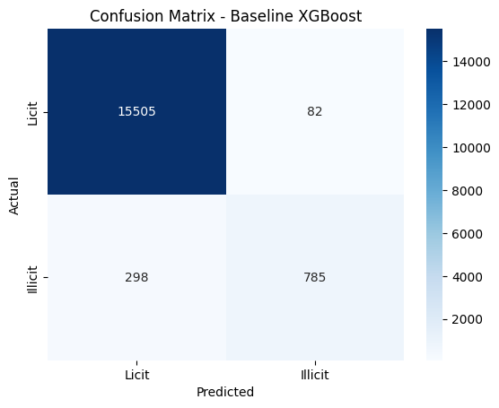

# Detecting Illicit Bitcoin Transactions (Anti-Money Laundering)

Applied machine learning on the Elliptic Bitcoin transaction dataset to flag illicit transactions. Stage 1 is a tree-based baseline (XGBoost). Stage 2 will test whether the transaction network structure improves detection using a Graph Neural Network.

## Why this problem matters
Serious and organised crime cost Australia up to $60.1 billion in 2020-21, according to Australian Institute of Criminology research cited by AUSTRAC [1]. Money laundering lets these groups profit from and reinvest their proceeds. AUSTRAC's 2024 national risk assessment found that honest businesses are regularly exploited by laundering networks [1][2], and its latest risk update recognises virtual assets and AI as growing enablers of financial crime, including the laundering of scam proceeds [3]. From 1 July 2026, Australia's AML/CTF regime expanded to cover higher-risk professional services such as lawyers, accountants and trust and company service providers [4]. 

Illicit transactions are rare, so a useful detection model must find them without overwhelming investigators with false alarms.

## References (IEEE Referencing Style)
[1] AUSTRAC, "Combating money laundering, terrorism financing and proliferation financing." Accessed: Oct. 6, 2026. [Online]   
    Available: https://www.austrac.gov.au/new-austrac/combating-money-laundering-terrorism-financing-and-proliferation-financing

[2] AUSTRAC, "Money laundering in Australia: National risk assessment 2024,"Jul. 2024. Accessed: Oct. 6, 2026. [Online]. 
    Available: https://www.austrac.gov.au/sites/default/files/2024-07/2024%20AUSTRAC%20Money%20Laundering%20NRA.pdf

[3] AUSTRAC, "AUSTRAC releases updated risk snapshot of Australia's financial crime landscape." Accessed: Oct. 6, 2026. [Online]. 
    Available: https://www.austrac.gov.au/news-and-media/media-release/austrac-releases-updated-risk-snapshot-australias-financial-crime-landscape

[4] Department of Home Affairs, "Overview of the AML/CTF Amendment Act." Accessed: Oct. 6, 2026. [Online]. 
    Available: https://www.homeaffairs.gov.au/criminal-justice/Pages/overview-of-the-amlctf-amendment-act.aspx

## Dataset
##### Elliptic Dataset
##### Source: https://www.kaggle.com/datasets/ellipticco/elliptic-data-set
- Elliptic Bitcoin dataset: 203,769 transactions (nodes) linked by payment flows (edges), across 49 time steps
- 165 anonymised features per transaction. Per the dataset documentation, the first 94 features represent local information about the transaction, and the remaining 72 features are aggregated features, obtained using transaction information one-hop backward/forward from the center node - giving the maximum, minimum, standard deviation and correlation coefficients of the neighbour transactions for the same information data
- Only 46,564 transactions are labelled (illicit or licit); the rest are
  unknown and were excluded from this stage

## Method
1. Data quality checks: 0 missing values, 0 duplicate rows or transaction IDs, all 165 features numeric (float64). Features appear already standardised, so no scaling was needed for models.
2. Time-based split: trained on time steps 1-34, tested on 35-49. This mimics predicting future transactions from past ones which is more realistic than a random split.
3. Model: XGBoost (100 trees, max depth 6), used default settings, no tuning.
4. Evaluation: precision, recall and F1 on the illicit class. Accuracy is reported but not relied on (see below).

## Results (test set: 16,670 transactions, 1,083 illicit)

| Model | Illicit precision | Illicit recall | Illicit F1 |
|---|---|---|---|
| XGBoost, all 165 features | 0.91 | 0.72 | 0.81 |
| XGBoost, local features only | 0.85 | 0.70 | 0.77 |
| XGBoost, all features except feature_5 | 0.89 | 0.73 | 0.80 |

Overall accuracy was 0.98, but this is misleading: a model that labelled everything "licit" would score about 93.5% accuracy on this test set while catching no illicit transactions.

Confusion matrix (all features): 

## Key findings
- Precision is high (0.91): when the model flags a transaction, it is right about 9 times in 10, so investigators see few false alarms.
- Recall is lower (0.72): roughly 1 in 4 illicit transactions is missed. In a real compliance setting this precision/recall trade-off is the central design decision.
- Neighbour-aggregated features add a modest improvement (F1 0.77 to 0.81, mostly via precision), so surrounding-transaction information carries some signal, but a tabular model already captures most of it.
- feature_5 has the highest importance (~0.5), yet removing it barely changes performance (F1 0.80). Other features carry overlapping information, so importance scores alone should not be read as "this feature is essential".

## Limitations
- Results come from a single run and a single time split, with no hyperparameter tuning or confidence intervals; differences of about 0.01 F1 are within noise.
- Features are anonymised, so findings are reported by feature number and cannot be interpreted in business terms.
- Feature importance describes what the model used, not what causes illicit behaviour.
- Cryptocurrency data is a proxy; real bank transaction data would differ.

## How to run
pip install pandas scikit-learn xgboost matplotlib seaborn jupyter

Put the three Elliptic CSV files in data/raw/ folder, then run the notebooks in order (data_exploration, baseline_model).
